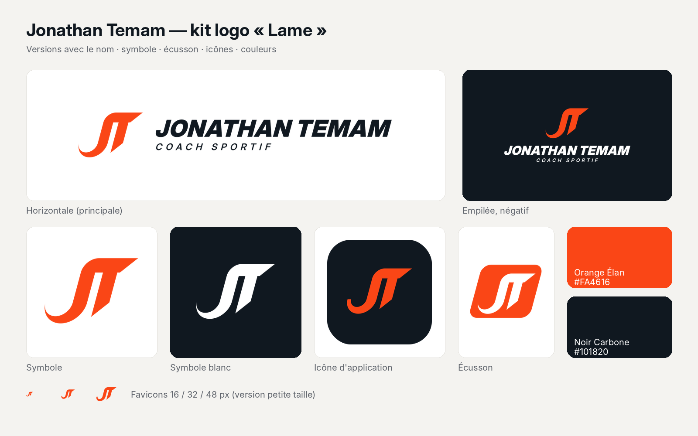

# Jonathan Temam — kit logo « Lame »

Le haut du J s'arrondit et devient une seule lame qui forme la barre du T. Le crochet du J s'effile comme une
traînée de vitesse. Le signe est incliné à 15°, avec des pointes coupées à 45°.

## Contenu

| Dossier / fichier | Contenu |
|---|---|
| `masters/` | Fichiers sources SVG : symbole (`jt-symbol-*`), version petite taille (`jt-symbol-small-*`), écusson (`jt-badge-*`), versions horizontale et empilée (`jt-horizontal-*`, `jt-stacked-*`) en couleur, négatif, noir, blanc et orange, nom seul (`jt-wordmark-*`) |
| `lockups/` | Versions avec le nom en SVG + PNG transparents (horizontale 1600 px, empilée 1200 px) |
| `symbol/` | Symbole en noir, blanc, orange, Noir Carbone, carré, favicon et icône d'application, en SVG + PNG 512/1024 |
| `web/` | `favicon.ico`, `favicon.svg`, PNG 16/32/48, `apple-touch-icon.png`, icônes 192/512 + maskable, `site.webmanifest`, `head-snippet.html` |
| `presentation.html`, `slides/` | Présentation : idée, logo final, 6 mises en situation (t-shirt, réseaux sociaux, icône d'app, cartes de visite, enseigne, tote bag) |
| `guide.html`, `guide.png` | Guide d'utilisation d'une page : versions, zone de protection, tailles minimales, couleurs, fonds, typographie, interdits |
| `tests.html` | Planche de tests : échelle 16–256 px, test pixel, une couleur, négatif, flou, miroir, contextes |
| `source/` | Scripts Python qui régénèrent tous les `masters/` (`python3 source/build_kit.py`, nécessite `fonttools` et `uharfbuzz`) |

## Couleurs

| Nom | HEX | RGB | CMJN | Pantone (le plus proche) |
|---|---|---|---|---|
| Orange Élan | #FA4616 | 250 70 22 | 0 82 96 0 | 172 C |
| Noir Carbone | #101820 | 16 24 32 | 75 60 45 90 | Black 6 C |

## Notes de remise

- Tous les fichiers sources sont en tracés : aucun texte de police, aucune image intégrée, aucun filtre. Le nom est composé en
  Inter Display Black (licence SIL OFL), avec le crénage de la police, puis incliné à 15° pour suivre le symbole.
- Tests effectués : audit SVG à 100/100 pour le symbole, la version petite taille et l'écusson. Pour les versions avec le
  nom, l'audit signale seulement les diagonales des lettres et les petits trous intérieurs du sous-titre, ce qui est normal
  pour du texte ; c'est pourquoi le guide fixe des tailles minimales. Le signe reste reconnaissable à 16 px, en une couleur
  et en négatif.
- À ne pas faire : poser le symbole orange sur un fond orange (utiliser la version blanche).
- Reste à faire par vous :
  - une recherche d'antériorité de marque (INPI / EUIPO) ;
  - une épreuve imprimeur pour valider les teintes CMJN et Pantone ;
  - pour la broderie, un fichier de points préparé par le brodeur à partir de `masters/jt-badge-color.svg`.
